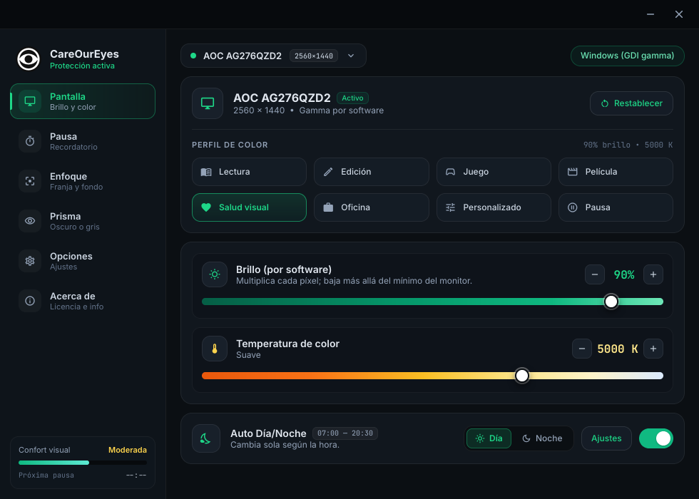

# CareOurEyes

Aplicación **libre y de código abierto** de cuidado visual: **brillo por software**
(por debajo del mínimo del monitor), **temperatura de color**, **perfiles por
pantalla** con valores de **día y de noche**, y cambio automático según la hora o el
amanecer y el atardecer.

*Free, open-source eye-care app: software dimming below your monitor's minimum,
color temperature, per-monitor day/night profiles. GPL-3.0.*



> **Versión 2 en desarrollo (alfa).** CareOurEyes se reescribió en **Rust + [Slint](https://slint.dev)**.
> Por ahora es **solo para Windows** y todavía faltan los descansos, el modo enfoque y
> Prisma ([ver el estado](#estado)).

## Descargar

Ve a **[Releases](https://github.com/DSGM-GMSD/CareOurEyes/releases)** y baja:

| Archivo | Para qué |
|---------|----------|
| `CareOurEyes-<versión>-setup.exe` | Instalador. Se instala en tu usuario, **sin permisos de administrador**, con acceso en el menú Inicio y desinstalador. |
| `CareOurEyes-<versión>-portable.exe` | El programa solo, sin instalar. |

Windows 10/11 de 64 bits. Windows SmartScreen puede avisar porque el archivo no está
firmado: «Más información» → «Ejecutar de todas formas».

### Verificar la descarga

Cada release incluye `SHA256SUMS` y una **atestación de procedencia** firmada por
GitHub, que prueba que el archivo se compiló desde esa etiqueta con el workflow
`release.yml` de este repositorio. Con [GitHub CLI](https://cli.github.com/):

```bash
gh attestation verify CareOurEyes-2.0.0-alpha.1-setup.exe -R DSGM-GMSD/CareOurEyes
```

---

## ¿Por qué otra app de este tipo?

| App | Problema |
|-----|----------|
| **f.lux** | Aplica un tono amarillo demasiado agresivo y no permite bajar el brillo por software de forma fina. |
| **LightBulb** | Se pelea con otras apps por la misma rampa gamma: parpadea alternando cálido/frío y no queda estable. |

**CareOurEyes** evita ese parpadeo por diseño: **captura la calibración original**
(ICC) de cada monitor y compone sus ajustes **encima** de ella, con **transiciones
suaves** en lugar de saltos. Al cerrar, devuelve la pantalla a como la encontró.

---

## Funcionalidades

- **Brillo por software**: multiplica cada píxel, así que 40 % es 40 % real, algo
  que el menú del monitor no permite. Nunca baja de 20 % (5 % con el rango
  ampliado), para que la pantalla no quede tan oscura que ya no puedas volver.
- **Temperatura de color**: de 1500 K (muy cálido) a 6500 K (neutro); con el rango
  ampliado, de 1000 K a 10000 K.
- **Perfiles**: Lectura, Edición, Juego, Película, Salud visual, Oficina y
  Personalizado, cada uno con valores **de día y de noche**, más **Pausa** (sin filtro).
  «Restablecer» devuelve el perfil activo a sus valores de fábrica.
- **Por monitor**: cada pantalla tiene su propia configuración.
- **Auto Día/Noche**: por horas fijas o por **amanecer/atardecer**, calculados en tu
  equipo a partir de latitud y longitud. Puedes escribirlas a mano o pulsar
  «Detectar mi ubicación» (consulta tu IP en ipwho.is por HTTPS, solo cuando lo
  pulsas). El cambio puede ser gradual, con la duración que elijas.
- **Vista previa**: si ajustas la noche mientras es de día (o al revés), la pantalla
  te muestra en vivo cómo se verá hasta que pulses «Listo».
- Bandeja del sistema con menú propio (mostrar, pausar o reanudar el filtro, salir),
  arrancar con Windows y restaurar las pantallas al salir.
- **Aviso de actualizaciones** opcional (consulta GitHub; no descarga nada sola).
- **Sin telemetría**: solo se conecta a internet si activas el aviso de
  actualizaciones o pulsas «Detectar mi ubicación». Los errores se guardan solo en
  tu equipo (`error.log`).
- **Idiomas**: español, English, 简体中文, 繁體中文, Deutsch, Nederlands, Italiano,
  Türkçe, Français y 日本語. Sigue el idioma del sistema o se elige en Opciones.
- Tema oscuro, claro o el del sistema, con 7 colores de acento.
- **Configuración en JSON** legible, compatible con la versión 1.

### Estado

| Función | Windows | Linux | macOS |
|---------|:-------:|:-----:|:-----:|
| Brillo, temperatura, perfiles y Auto Día/Noche | ✅ | 🔜 | 🔜 |
| Bandeja y arrancar al iniciar sesión | ✅ | 🔜 | 🔜 |
| Descansos (20-20-20, Pomodoro) | 🔜 | 🔜 | 🔜 |
| Enfoque y Prisma | 🔜 | — | — |
| Atajos de teclado y reglas por app | 🔜 | — | — |

🔜 = planeado. Mientras tanto, los ajustes de esas secciones que ya existan en
`config.json` se conservan intactos.

---

## Cómo funciona (lo importante)

Todas las apps de este tipo manipulan la **tabla de transferencia (gamma LUT)** de
la GPU: una tabla de 3 × 256 entradas que mapea cada intensidad de entrada a una
de salida. Escribiendo ahí se consiguen dos cosas que el control de brillo del
monitor **no** puede hacer:

1. **Bajar el brillo por debajo del mínimo del panel**, porque se escala cada
   píxel en lugar de reducir la retroiluminación.
2. **Desplazar el punto blanco** (cálido/frío) escalando los canales R, G y B de
   forma desigual.

### El problema de la convivencia

Windows permite que **cualquier** aplicación escriba esa tabla. La luz nocturna de
Windows, f.lux, LightBulb, el cargador de perfiles ICC y el propio driver compiten
por ella. Eso es lo que hace que LightBulb "parpadee": dos apps se sobreescriben
varias veces por segundo.

CareOurEyes lo evita así:

1. Al arrancar, **captura** la LUT de cada monitor (tu calibración ICC).
2. Compone sus ajustes **sobre** esa base, no sobre una rampa lineal.
3. Desliza los cambios en lugar de saltar.
4. Al salir, **restaura** la base capturada tal cual.

En Windows usa `CreateDC("DISPLAY", "\\.\DISPLAYn")` y `SetDeviceGammaRamp` (gdi32).
Windows limita cuánto puede oscurecer una rampa; si la función pública la rechaza,
la app usa la variante de `mscms.dll`, salvo que actives
**Opciones › Pantalla › Ajuste estándar**.

---

## Compilar desde el código

Requisitos: [Rust](https://rustup.rs) 1.95 o superior y, en Windows, las *Build Tools*
de Visual Studio (rustup las ofrece al instalar).

```bash
cargo run --release      # ejecutar la app
cargo test               # pruebas
```

El ejecutable queda en `target/release/CareOurEyes.exe`. Para arrancar oculto en la
bandeja: `CareOurEyes.exe --autostart`. En Linux y macOS compila con un simulador de
pantallas, útil para trabajar en la interfaz.

| Carpeta | Contenido |
| --- | --- |
| `src/config.rs` | `config.json` |
| `src/color.rs` | Kelvin → RGB y rampa gamma |
| `src/schedule.rs` | Horario día/noche y cálculo solar |
| `src/i18n.rs`, `i18n/` | Traducciones |
| `src/app.rs` | Estado de la app y conexión con la interfaz |
| `src/platform/windows/` | Rampa gamma GDI, bandeja, autoarranque |
| `ui/` | Interfaz Slint |
| `packaging/` | Instalador (Inno Setup) |

### Publicar una versión

La etiqueta es el acto de publicar. `.github/workflows/release.yml` hace el resto
cuando se sube una etiqueta `v*`: comprueba que coincide con la versión de
`Cargo.toml`, compila, crea el instalador y el portable, los atesta, escribe
`SHA256SUMS` y crea el release.

1. Cambia `version` en `Cargo.toml` y compila una vez para que se actualice `Cargo.lock`.
2. Sube ese commit a `main`.
3. Crea la etiqueta anotada sobre ese commit y súbela:

   ```bash
   git tag -a v2.0.0-alpha.2 -m "CareOurEyes v2.0.0-alpha.2"
   git push origin v2.0.0-alpha.2
   ```

Una versión con guion (`-alpha.2`, `-rc1`) se publica como pre-release.

Configuración del usuario: `%APPDATA%\CareOurEyes\config.json`.

---

## Contribuir

Los reportes de fallos y los pull requests son bienvenidos. Si algo falla, adjunta
el archivo `error.log` que está junto a `config.json` (Opciones › General ›
«Abrir carpeta de registros»).

Los pull requests los revisa [CodeRabbit](https://coderabbit.ai). Es gratis en un
repositorio público y no es un check obligatorio: comenta, no bloquea el merge. Con
menos de 10 estrellas la revisión no arranca sola; hay que pulsar **Trigger review**
o comentar `@coderabbitai review`.

### Traducciones

Los textos están en `i18n/`. `messages.properties` es el español (idioma base) y
cada `messages_<código>.properties` es una traducción.

- **Corregir una traducción:** edita el archivo de ese idioma y abre un pull request.
- **Agregar un idioma:** copia `messages.properties` como `messages_<código>.properties`
  (por ejemplo `messages_pt.properties`), traduce solo el texto a la derecha del `=`,
  conserva `{0}`, `{1}`… y agrega el código a `LANGUAGES` y a `source()` en `src/i18n.rs`.

Las traducciones (todas salvo el español) se hicieron con ayuda de IA; se agradece
la revisión de hablantes nativos.

## Créditos y licencias

- CareOurEyes: **GPL-3.0**, ver [LICENSE](LICENSE).
- [Slint](https://slint.dev), usado bajo su licencia GPLv3.
- Iconos [Material Icons](https://github.com/google/material-design-icons): Apache 2.0.
- Fuentes **Inter** y **JetBrains Mono**: SIL Open Font License 1.1 (textos en `ui/fonts/`).
- Conversión de temperatura a RGB: ajuste público de Tanner Helland.
- CareOurEyes es un proyecto independiente; no está afiliado a CareUEyes, a f.lux ni a
  LightBulb.
